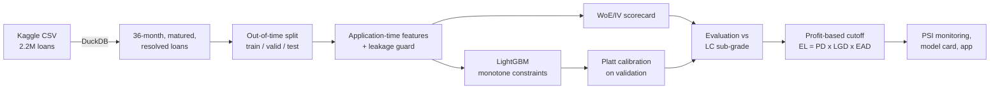

# Lending Club Credit Risk: an out-of-time validated PD model


Predicts the **probability of default (PD)** of a 36-month Lending Club loan from information available
at application time, then turns that probability into an approve/decline rule and checks it against
the money those loans actually made or lost.

The project is built the way a bank's credit-risk team would build it, not the way a Kaggle notebook
usually does:

- **No leakage.** A lineage-aware guard blocks every column that was only known after the loan was
  issued (payments, recoveries, refreshed FICO scores, settlements) and fails the build if one slips in.
- **Out-of-time validation.** Train on 2007 to mid-2014 loans, tune on late 2014, test once on 2015.
  No random split.
- **No right-censoring bias.** Only loans whose full term ended before the data snapshot are used, so
  unfinished recent loans can't distort the default rate.
- **Two models, one benchmark.** A WoE/IV logistic scorecard (the industry standard) against a
  monotone-constrained LightGBM, both compared with **Lending Club's own sub-grade**.
- **Calibrated probabilities**, judged with Brier score and decile calibration, not just AUC.
- **Business decision.** Expected loss = PD x LGD x EAD, and an approval cutoff chosen on validation
  by back-testing realised profit, then applied unchanged to the test year.
- **Monitoring.** Population Stability Index for the score and every feature, plus a vintage
  stability view.
- **Explainability.** Scorecard points and reason codes, plus TreeSHAP for LightGBM.

## Results

Out-of-time test on **283,026 unseen 2015 loans** (trained on 2007 to mid-2014, 621,022 loans in total):

| Model | Test Gini (95% CI) | KS | Brier |
|---|---:|---:|---:|
| WoE scorecard (7 features) | 0.289 (0.284-0.294) | 0.208 | 0.1231 |
| LightGBM, calibrated | **0.338** (0.333-0.343) | 0.245 | **0.1211** |
| Lending Club sub-grade (benchmark) | 0.357 (0.353-0.363) | 0.262 | 0.1214 |

- LightGBM gets within 0.02 Gini of Lending Club's own grade using public application data only,
  and its probabilities are slightly better calibrated (lower Brier).
- **Leakage check:** adding one post-issue FICO column inflates test AUC from 0.669 to 0.939.
  The guard blocks it.
- **Policy finding:** a profit-maximising cutoff chosen on validation approved every loan.
  Lending Club's interest rates already covered expected losses in every risk band (before funding
  costs), so the PD model adds value through pricing, not through declining loans.

Full details, figures and limitations: [`reports/model_card.md`](reports/model_card.md).

## How it works



| Stage | File | What it does |
|---|---|---|
| Load | `src/creditrisk/data.py` | DuckDB parses the 1.6 GB CSV, casts types, filters the population, caches Parquet |
| Leakage guard | `src/creditrisk/leakage.py` | Default-deny allowlist plus lineage check of engineered features |
| Features | `src/creditrisk/features.py` | Same function in training and serving; drops fields whose availability changes over time |
| Split | `src/creditrisk/split.py` | Out-of-time split by issue date |
| Scorecard | `src/creditrisk/woe.py`, `scorecard.py` | Monotonic WoE binning, IV selection, logistic regression, points (600 = 50:1 odds, PDO 20), reason codes |
| LightGBM | `src/creditrisk/gbm.py` | Early stopping out-of-time, monotone constraints, native categoricals, TreeSHAP |
| Calibration | `src/creditrisk/calibration.py` | Platt recalibration (keeps the ranking) or isotonic |
| Metrics | `src/creditrisk/metrics.py` | AUC, Gini with bootstrap CI, KS, Brier, ECE, lift table |
| Policy | `src/creditrisk/policy.py` | LGD/EAD from training defaults, profit curve, cutoff, like-for-like comparison with sub-grade |
| Monitoring | `src/creditrisk/monitoring.py` | PSI/CSI and per-quarter stability |
| Report | `src/creditrisk/report.py` | `metrics.json`, `model_card.md` and auto-filled resume bullets |
| App | `app/streamlit_app.py` | Score one applicant: PD, points, decision, expected loss, reasons |

## Quickstart

```bash
git clone https://github.com/Dhruv75/lending-club-credit-risk.git
cd lending-club-credit-risk
python -m venv .venv && source .venv/bin/activate      # Windows: .venv\Scripts\activate
pip install -e ".[app,dev]"

python -m pytest                                       # 50 tests, synthetic data, about 10 s
python -m creditrisk.pipeline --demo                   # full run on synthetic data -> runs/demo/
```

### Run on the real data

1. Download the Kaggle dataset **"All Lending Club loan data"** (`wordsforthewise/lending-club`), either
   from the Kaggle website or with the Kaggle CLI:
   `kaggle datasets download -d wordsforthewise/lending-club -p data/raw --unzip`
2. Leave `accepted_2007_to_2018Q4.csv.gz` (or the unzipped `.csv`) anywhere under `data/raw/`.
   The loader finds it.
3. Train and evaluate:

```bash
python -m creditrisk.pipeline          # or: make train
streamlit run app/streamlit_app.py     # or: make app
```

The first run parses the CSV with DuckDB, which takes a few minutes, and caches the result in
`data/processed/`. After that a full run takes a few minutes on a laptop. Outputs:

```
reports/model_card.md      <- start here
reports/metrics.json
reports/figures/*.png      ROC, KS, calibration, profit curve, PSI, SHAP, WoE bins, vintages, leakage
reports/tables/*.csv       IV, scorecard points, WoE bins, lift, calibration, PSI, vintages, profit curve
models/bundle.joblib       scorecard + LightGBM + calibrator + cutoff, used by the app
```

Commit `reports/` after the real run so the model card and figures show on GitHub.
`runs/` (synthetic demo output) and the data are git-ignored.

## Key design decisions

**Population.** Only 36-month loans, so every loan in the study has the same horizon. Loans whose
scheduled end date is after the status snapshot (end of 2018) are excluded. Their outcome is not
known yet. The recent loans that have already resolved are a biased sample: a default resolves
within a year or two, while most good loans are still being repaid, so their default rate is
usually inflated (for the very newest loans, early payoffs can push it the other way).
"Fully Paid" counts as good. "Charged Off" and "Default" count as bad.

**What is not a feature.** Anything recorded after issuance (repayments, recoveries, `last_fico_*`,
hardship and settlement fields). Lending Club's own decision outputs (`grade`, `sub_grade`,
`int_rate`, `installment`), because the model is meant to make that decision, not copy it.
Identifiers, free text and geography (`zip_code`, `addr_state`), because geography can stand in for
protected characteristics. Post-origination columns are still loaded, but only to measure outcomes
(the default flag, realised profit, loss given default).

**Fields that appear over time.** Some bureau fields only exist from 2012 onwards. In an out-of-time
setup their "missing" value would secretly encode the issue date, so the pipeline drops features
that are missing in more than 30% of training rows, or whose missing rate shifts by more than 10
points between train and validation. The exceptions are "months since last delinquency / record",
where missing means "never".

**Benchmark.** Each sub-grade's default rate in the training period becomes a PD. That gives a
like-for-like Gini and an approval-policy comparison at the same approval rate. Lending Club also saw
information the public file lacks, so matching it from public data alone is a fair result.

## Limitations

- Outcomes exist only for approved loans, so the model never learns from rejected applicants
  (selection bias; no reject inference).
- 2016 and later vintages are excluded because their 36-month terms had not ended by the snapshot.
- Realised profit ignores discounting, servicing fees and funding costs.
- The data has no protected attributes, so no fair-lending test was run; geography is excluded as a
  likely proxy.

## Tests

`python -m pytest` runs the suite on a synthetic file with the exact Lending Club schema. The tests
cover the loader (including the original LendingClub header line and percent strings), the leakage
guard, the split, WoE/IV properties, scorecard scaling, metrics, calibration, PSI, the cutoff logic,
an end-to-end pipeline run, the monotone constraint on FICO and a headless run of the Streamlit app.
The synthetic data (`src/creditrisk/synthetic.py`) exists only for testing. Its numbers mean nothing
and are never reported.

## License

MIT
