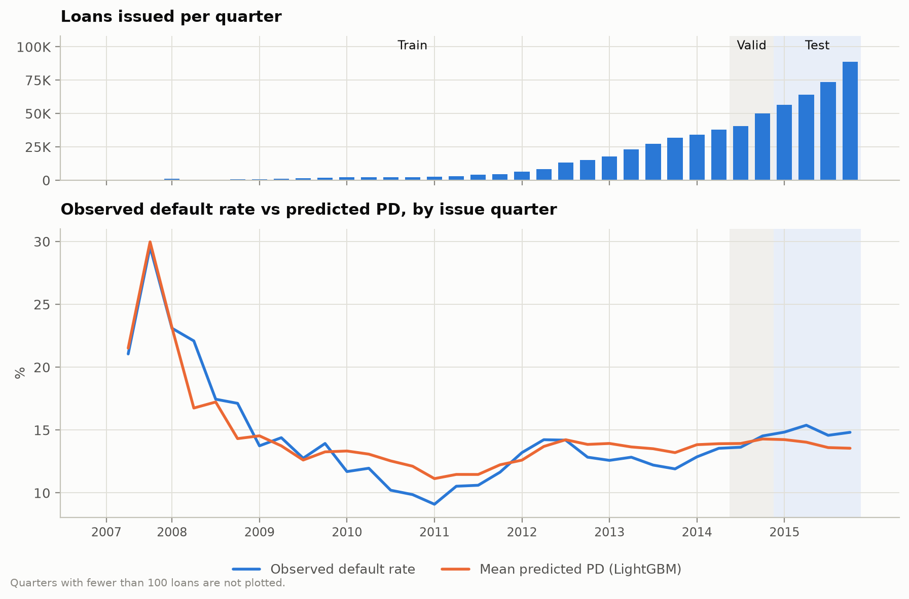
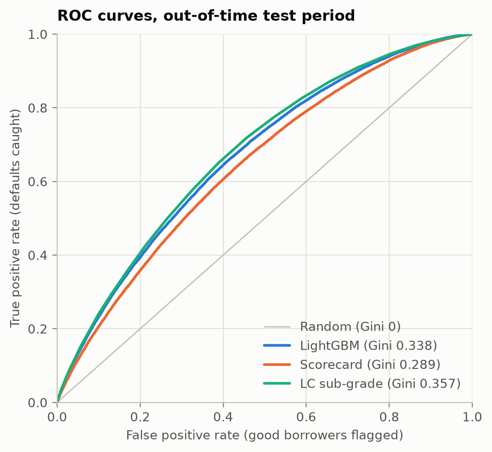
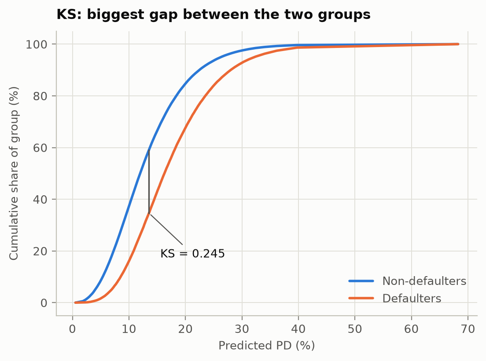
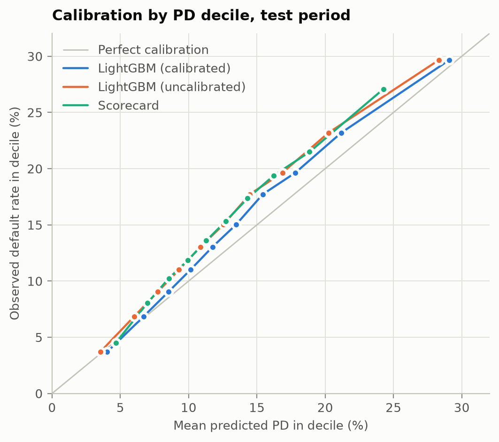
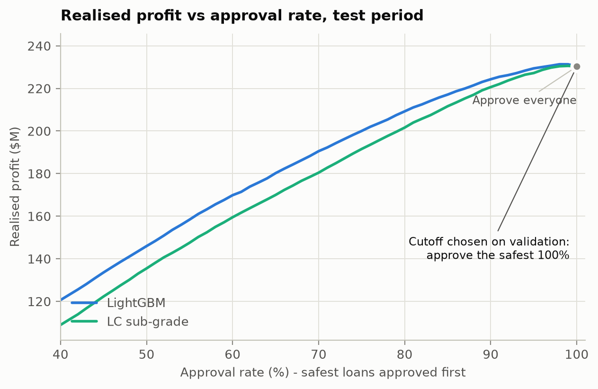
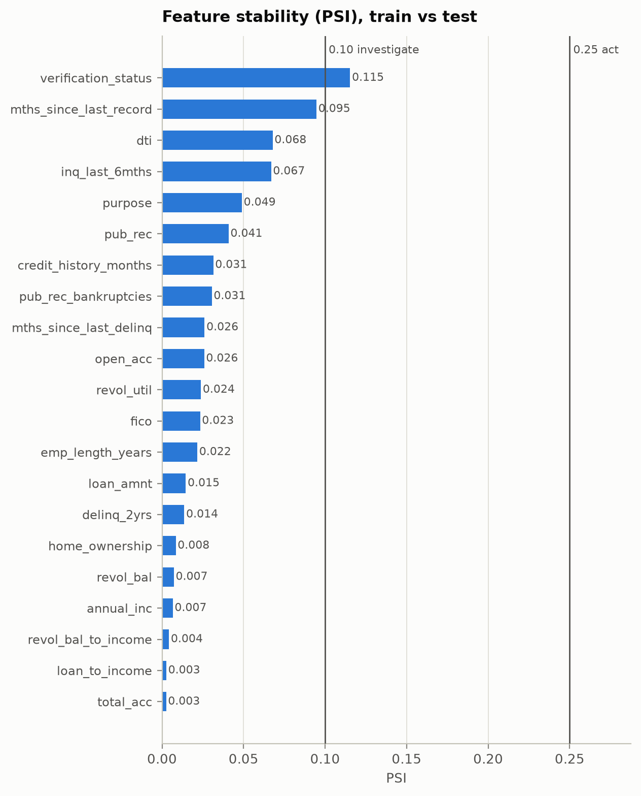
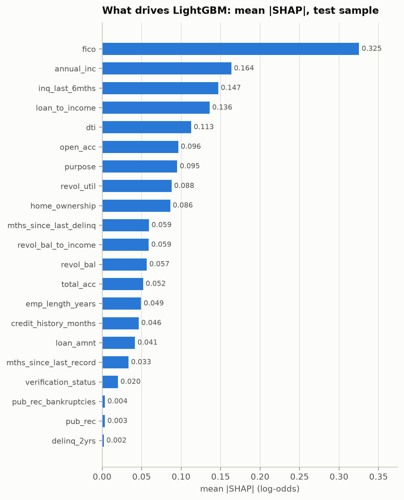
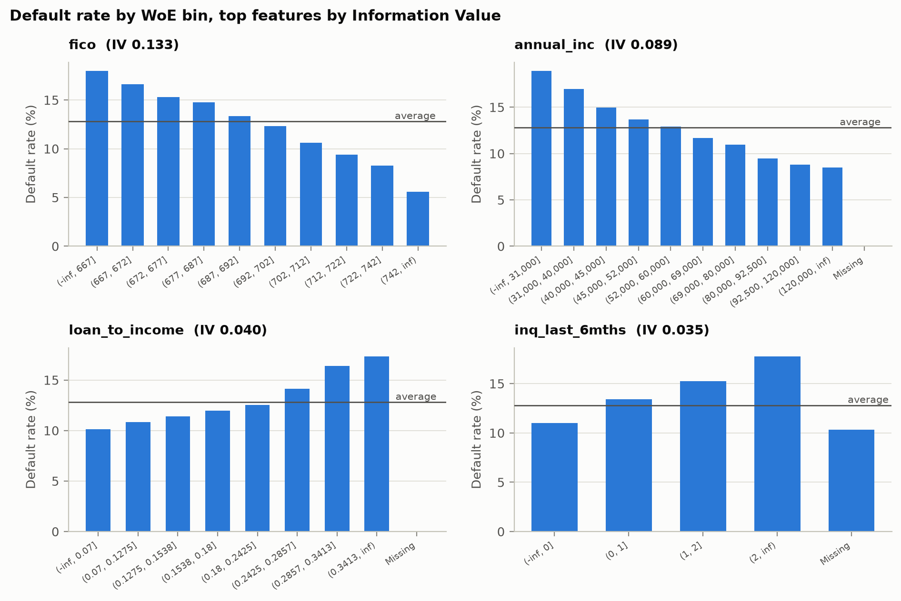
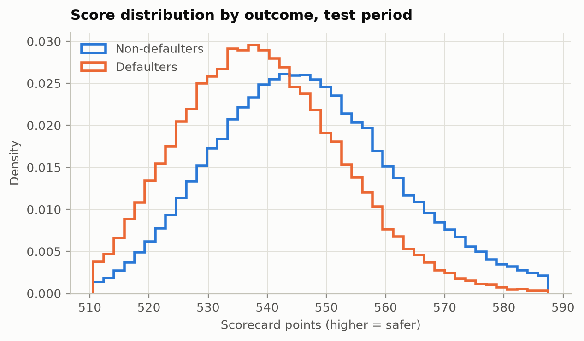
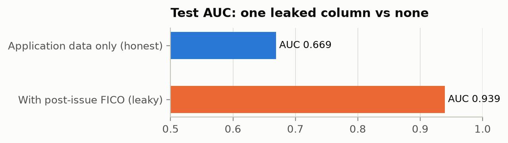

# Model card: Lending Club probability-of-default model

Generated 2026-11-01 10:41 UTC from `accepted_2007_to_2018Q4.csv` in 115s.

## 1. Population

| Step | Loans |
|---|---:|
| All loans in the file | 2,260,668 |
| 36-month term | 1,609,754 |
| Term ended before the status snapshot (2018-12-31) | 621,169 |
| Final outcome known (fully paid or charged off) | 621,022 |
| Issued inside the study window | 621,022 |

## 2. Out-of-time split

| Split | Issued from | Issued before | Loans | Default rate |
|---|---|---|---:|---:|
| train | 2007-01-01 | 2014-07-01 | 247,381 | 12.8% |
| valid | 2014-07-01 | 2015-01-01 | 90,615 | 14.1% |
| test | 2015-01-01 | 2016-01-01 | 283,026 | 14.9% |

## 3. Features

The leakage guard keeps 59 raw columns (post-origination, lender decision, identifiers, free text, geography) out of the model. Every input must be on a reviewed allowlist and the raw columns it is built from are checked too.

Dropped because the field is not reliably available over time:

| Feature | Reason |
|---|---|
| `mort_acc` | missing rate moved 15% -> 0% (field availability changed) |
| `acc_open_past_24mths` | missing rate moved 15% -> 0% (field availability changed) |
| `bc_util` | missing rate moved 16% -> 1% (field availability changed) |
| `tot_cur_bal` | missing rate moved 22% -> 0% (field availability changed) |

**Scorecard** (7 features, ranked by Information Value):

| Feature | IV | Meaning |
|---|---:|---|
| `fico` | 0.133 | FICO score at application (mid-point of range) |
| `annual_inc` | 0.089 | Self-reported annual income |
| `loan_to_income` | 0.040 | Loan amount / annual income |
| `inq_last_6mths` | 0.035 | Credit inquiries in the last 6 months |
| `dti` | 0.035 | Debt-to-income ratio (%), excluding this loan |
| `home_ownership` | 0.032 | Home ownership (rent / own / mortgage) |
| `revol_util` | 0.029 | Revolving utilisation (%) |

Left out of the scorecard:

| Feature | Reason |
|---|---|
| `credit_history_months` | IV 0.020 below 0.02 (no useful signal) |
| `purpose` | IV 0.017 below 0.02 (no useful signal) |
| `emp_length_years` | IV 0.015 below 0.02 (no useful signal) |
| `revol_bal` | IV 0.014 below 0.02 (no useful signal) |
| `total_acc` | IV 0.012 below 0.02 (no useful signal) |
| `revol_bal_to_income` | IV 0.008 below 0.02 (no useful signal) |
| `loan_amnt` | IV 0.006 below 0.02 (no useful signal) |
| `pub_rec_bankruptcies` | IV 0.006 below 0.02 (no useful signal) |
| `mths_since_last_record` | IV 0.002 below 0.02 (no useful signal) |
| `verification_status` | IV 0.002 below 0.02 (no useful signal) |
| `mths_since_last_delinq` | IV 0.001 below 0.02 (no useful signal) |
| `pub_rec` | IV 0.001 below 0.02 (no useful signal) |
| `delinq_2yrs` | IV 0.001 below 0.02 (no useful signal) |
| `open_acc` | IV 0.000 below 0.02 (no useful signal) |

**LightGBM** uses all 21 features; early stopping on the validation period chose 325 trees. Monotone constraints: `fico` (-), `dti` (+), `inq_last_6mths` (+), `revol_util` (+), `loan_to_income` (+).

## 4. Performance

| Model | Train Gini | Valid Gini | Test Gini (95% CI) | Test KS | Test Brier | Test ECE |
|---|---:|---:|---:|---:|---:|---:|
| Scorecard | 0.288 | 0.291 | 0.289 (0.284-0.294) | 0.208 | 0.1231 | 0.0214 |
| LightGBM | 0.425 | 0.337 | 0.338 (0.333-0.343) | 0.245 | 0.1211 | 0.0114 |
| LightGBM (uncalibrated) | 0.425 | 0.337 | 0.338 (0.333-0.343) | 0.245 | 0.1214 | 0.0190 |
| LC sub-grade (benchmark) | 0.286 | 0.334 | 0.357 (0.353-0.363) | 0.262 | 0.1214 | 0.0237 |

Gini = 2 x AUC - 1. ECE = average gap between predicted and observed default rate across PD deciles. LightGBM rows use calibrated PDs unless marked otherwise.

**Leakage check.** Adding `last_fico_range_high`, `last_fico_range_low` (a FICO score pulled after the loan was issued) lifts test AUC from 0.669 to 0.939. That jump is what leakage looks like; the guard blocks these columns.

## 5. Calibration and lift (test period, LightGBM)

Platt recalibration fitted on the validation period: slope 0.957, intercept -0.002. Mean predicted PD 13.81% vs observed default rate 14.89%.

The riskiest 10% of loans hold 19.9% of all defaults (lift 1.99x); the riskiest 20% hold 35.5%.

## 6. Approval policy (back-test on the test period)

From 31,672 defaulted training loans: exposure at default = 57.8% of the loan amount, loss given default = 89.5%. Cutoff chosen on validation: approve if PD <= 70.45% (approval rate 100% in validation).

| Policy on test loans | Approval rate | Default rate | Realised profit | Return on funded |
|---|---:|---:|---:|---:|
| Approve everyone | 100.0% | 14.9% | $230.27M | 6.35% |
| Model cutoff (PD threshold) | 100.0% | 14.9% | $230.27M | 6.35% |
| LC sub-grade, same approval rate | 100.0% | 14.9% | $230.27M | 6.35% |

The cutoff turns away 0.0% of the loans that defaulted and 0.0% of the loans that were repaid. Expected loss on the test book (PD x LGD x EAD) was $250.02M against $274.01M realised.

## 7. Stability

Score PSI, train -> valid: 0.006 (stable); train -> test: 0.001 (stable).

| Feature | PSI train -> test | Status |
|---|---:|---|
| `verification_status` | 0.115 | moderate shift |
| `mths_since_last_record` | 0.095 | stable |
| `dti` | 0.068 | stable |
| `inq_last_6mths` | 0.067 | stable |
| `purpose` | 0.049 | stable |
| `pub_rec` | 0.041 | stable |

## 8. Figures

## 9. Resume bullets (numbers from this run)

- Built an out-of-time-validated probability-of-default model on 621,022 Lending Club loans (trained on 2007-2014 vintages, tested on unseen 2015 loans): a WoE/IV scorecard and a monotone-constrained LightGBM reached test Gini 0.29 / 0.34 vs 0.36 for Lending Club's own sub-grade, which also uses data the public file lacks.
- Wrote a lineage-aware leakage guard that keeps 59 post-origination, lender-decision and identifier columns out of the model (one leaked post-issue FICO field inflated test AUC from 0.67 to 0.94); calibrated PDs to a test Brier score of 0.121.

## 10. Limitations

- Outcomes exist only for loans Lending Club approved, so the model never learns from rejected applicants (selection bias; reject inference is not attempted).
- 36-month loans only, and only vintages whose term ended before the status snapshot, so the newest data (2016+) is not used.
- Realised profit ignores the time value of money, servicing fees and funding costs.
- The sub-grade benchmark comes from Lending Club's own model, which saw information the public file does not include.
- No protected attributes are in the data, and geography is excluded as a likely proxy; a full fair-lending review would still be needed before any real use.
